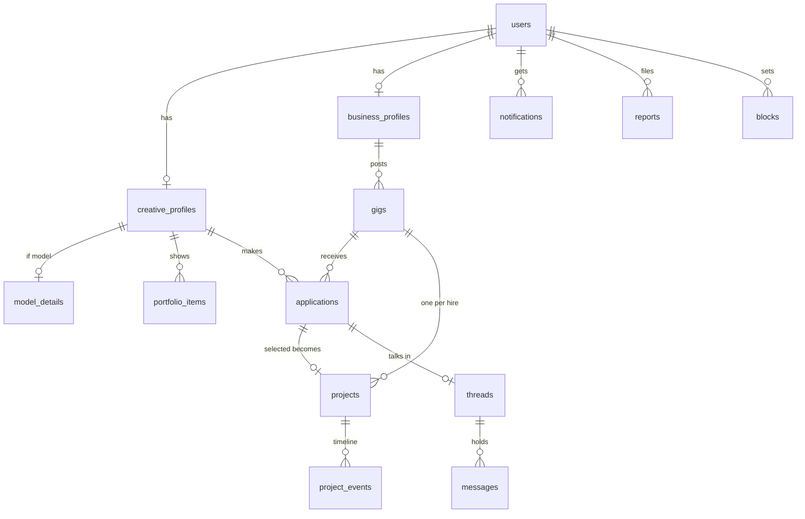

# Data model (first draft)

Postgres on Supabase. Migrations in `supabase/migrations/` are the only source of truth for the schema. This page explains the shape and the rules; it doesn't replace the SQL. Every table has row-level security (RLS) turned on, and every policy below gets a `db` test.

## Entities

## Tables

| Table | Key columns | Notes |
| --- | --- | --- |
| `users` | `id` (= auth user), `full_name`, `email`, `phone`, `acting_as` (`creative`/`business`), `terms_accepted_at`, `deleted_at` | One row per person. Account types are the profiles that exist |
| `creative_profiles` | `user_id`, `display_name`, `title`, `bio`, `creative_types text[]`, `skill_tags text[]`, `area`, `instagram_handle`, `website_url`, `rate_min_cents`, `rate_max_cents`, `search tsvector` | `creative_types` uses the talent call list: model, photographer, videographer, designer, stylist, hair_makeup, other |
| `model_details` | `creative_id`, `height_inches`, `bust`, `waist`, `hips`, `shoe`, `eyes`, `hair` | Same fields and limits as `talent_call_submissions` |
| `business_profiles` | `user_id`, `business_name`, `business_type`, `area`, `about`, `logo_path`, `website_url`, `instagram_handle`, `contact_name` | |
| `media` / `portfolio_items` | `owner_id`, `kind` (portfolio, headshot, full_length, logo), `storage_path`, `video_url`, `position` | Images in Supabase Storage, one bucket per kind |
| `gigs` | `id`, `business_id`, `posted_by_team` bool, `title`, `gig_type`, `creative_types_needed text[]`, `description`, `starts_at`, `ends_at`, `flexible_dates`, `location`, `is_remote`, `pay_type` (flat, hourly, day_rate, collab), `pay_cents`, `hires_needed`, `deliverables`, `requirements`, `usage_rights`, `apply_by`, `status` (draft, open, filled, closed), `search tsvector` | Status changes only through functions, so `filled` stays correct |
| `applications` | `id`, `gig_id`, `creative_id`, `source` (apply, invite), `note`, `status` (invited, applied, shortlisted, not_a_fit, selected, withdrawn, declined), timestamps | Unique on (`gig_id`, `creative_id`) |
| `projects` | `id`, `gig_id`, `application_id`, `business_id`, `creative_id`, `stage` (scheduled, in_progress, delivered, completed, cancelled), `agreed_pay_cents`, `pay_type`, `business_confirmed_at`, `creative_confirmed_at`, `completed_at`, `final_pay_cents`, `cancel_reason`, `flagged` | One business and one creative, always (business plan §4.4). Contract, invoice and payment are separate tables added at Public Launch, keyed on `project_id` |
| `project_events` | `project_id`, `actor_id`, `kind` (stage_change, milestone, pay_change, confirm, flag, cancel), `data jsonb`, `created_at` | The timeline, and the audit trail |
| `threads` / `messages` | `threads.application_id`, `threads.project_id`; `messages.thread_id`, `sender_id`, `body`, `read_at` | Realtime subscription per thread |
| `notifications` | `user_id`, `kind`, `data jsonb`, `read_at`; plus `push_tokens`, `email_prefs` | |
| `reports` / `blocks` | `reporter_id`, `target_kind`, `target_id`, `reason`, `status`; `blocker_id`, `blocked_id` | |
| `invite_codes` / `invite_redemptions` | `code`, `max_uses`, `uses`, `revoked_at`, `created_by`; `code_id`, `user_id` | |
| `team_members` | `user_id`, `email`, `role` | Allow-list for the team page and the team's read access |
| `change_requests` | `title`, `body`, `requested_by`, `status` (suggested, approved, in_build, done, not_doing) | From the team page |
| `talent_call_submissions`, `business_interest_submissions` | existing | Import source for ACC-04. `status = 'imported'` once claimed |

## Who can see what (RLS summary)

| Data | Read | Write |
| --- | --- | --- |
| Profiles, portfolio, model details | Any signed-in user not blocked by the owner | Owner |
| Open gigs | Any signed-in user not blocked by the business | Business owner, or team on its behalf |
| Applications | The creative and the gig's business | Creative creates and withdraws; business changes status |
| Projects, project events | The two participants and the team | Participants, through functions that check the stage rules |
| Threads, messages | Participants only (not the team, unless a message is reported) | Participants |
| Submissions, invite codes, change requests, reports | Team only | Public insert for submissions (as today); team for the rest |

Is the team allowed to read private messages? This draft says no, unless a message is reported. It's listed as Q5.

## State machines

**Gig:** `draft → open → filled` or `open → closed`. Cancelling a project reopens `filled` to `open` if hire slots free up.

**Application:** `invited → applied | declined`; `applied → shortlisted | not_a_fit | withdrawn | selected`; `shortlisted → selected | not_a_fit | withdrawn`.

**Project:** `scheduled → in_progress → delivered → completed`, with `cancelled` possible from any stage before `completed`. `completed` needs both confirm timestamps.

## Analytics events (PostHog)

`signup_started`, `signup_completed`, `profile_claimed`, `gig_posted`, `gig_viewed`, `application_sent`, `invite_sent`, `creative_selected`, `project_stage_changed`, `project_completed`, `message_sent`. These feed the success measures in [O-001_beta-1-runs-the-gig-loop.md](../outcomes/O-001_beta-1-runs-the-gig-loop.md).
