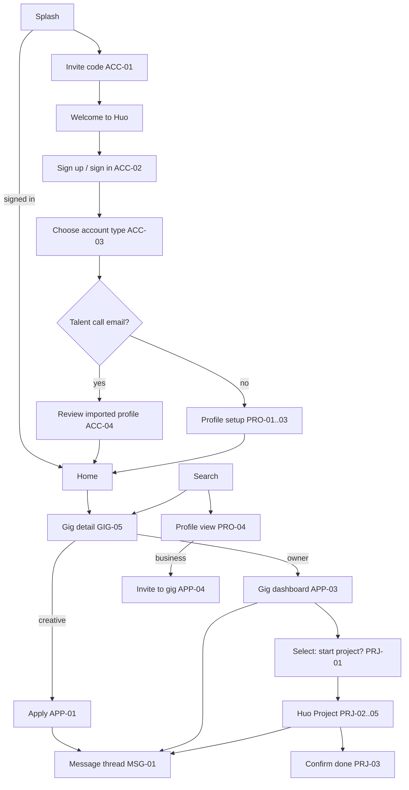

# Sitemap

Screens for Beta 1, using the business plan's navigation (§3.3) with the feed swapped out for D-009. Routes are expo-router paths. Story IDs are in brackets.

## Navigation

Bottom nav, five tabs, the same for both account types. What each tab shows depends on which account type you're acting as.

| Tab | Creative sees | Business sees |
| --- | --- | --- |
| **Home** `/(tabs)/home` | Gigs for you, my active projects, invites waiting | My open gigs with new-applicant counts, active projects |
| **Search** `/(tabs)/search` | Gigs (default) and creatives | Creatives (default) and gigs |
| **+** (action sheet) | Add portfolio work | Post a gig |
| **Messages** `/(tabs)/messages` | Inbox | Inbox |
| **Profile** `/(tabs)/profile` | My profile, projects, settings | My business profile, projects, settings |

The business plan's Home is a portfolio and community feed. Beta 1 has no feed (D-009), so Home is a dashboard. See Q2.

## Flow

## Screen list

| # | Screen | Route | Stories | Rob's reference |
| --- | --- | --- | --- | --- |
| 1 | Splash | `/` | – | wireframes: splash |
| 2 | Invite code | `/(auth)/code` | ACC-01 | wireframes: beta code |
| 3 | Welcome to Huo | `/(auth)/welcome` | ACC-01 | `SplashWelcomeModal` |
| 4 | Sign up / sign in | `/(auth)/sign-in` | ACC-02 | wireframes: login |
| 5 | Enter code | `/(auth)/verify` | ACC-02 | – |
| 6 | Account type | `/(onboarding)/type` | ACC-03 | wireframes: account type |
| 7 | Review imported profile | `/(onboarding)/review` | ACC-04 | – |
| 8 | Creative setup (basics, tags, portfolio, model details) | `/(onboarding)/creative/*` | PRO-01, PRO-02 | `ProfileScreen`, onboarding form |
| 9 | Business setup | `/(onboarding)/business` | PRO-03 | – |
| 10 | Home | `/(tabs)/home` | GIG-03, PRJ-04 | `HomeScreen` (reworked, no feed) |
| 11 | Search: gigs and creatives | `/(tabs)/search` | GIG-03, GIG-04 | `DiscoverScreen` |
| 12 | Gig detail | `/gig/[id]` | GIG-05, APP-01, APP-02 | Discover gig card, `PostGigModal` |
| 13 | Post / edit gig | `/gig/new`, `/gig/[id]/edit` | GIG-01, GIG-02 | `PostGigModal` |
| 14 | Gig dashboard (applicants) | `/gig/[id]/applicants` | APP-03, PRJ-01 | – (new) |
| 15 | Profile view | `/u/[id]` | PRO-04, APP-04, SAF-02, SAF-03 | `ProfileScreen` |
| 16 | Comp card | `/u/[id]/comp-card` | PRO-02 | – (new) |
| 17 | My profile and edit | `/(tabs)/profile`, `/profile/edit` | PRO-05 | `ProfileScreen` |
| 18 | Projects list | `/projects` | PRJ-04 | – (new) |
| 19 | Huo Project | `/project/[id]` | PRJ-01..05 | `MessagesScreen` proposal card (idea only) |
| 20 | Inbox | `/(tabs)/messages` | MSG-02 | `MessagesScreen` |
| 21 | Thread | `/thread/[id]` | MSG-01 | `MessagesScreen` |
| 22 | Notifications | `/notifications` | NOT-01 | – |
| 23 | Invites | `/invites` | APP-04 | – |
| 24 | Settings (account types, email prefs, terms, delete account) | `/settings` | ACC-03, ACC-05, NOT-01, SAF-01 | `SettingsDrawer` |
| 25 | Report | modal | SAF-02 | – |

**Team page** (web only, on the CTA site or `/team` in the app's web build; decided during M1): signups, invite codes, gigs and projects, reports, suggest-a-change. Stories TEAM-01 to TEAM-04.

**Rob's references** point at components in the current repo's prototype (`src/components/screens/*`) and `Design Reference/huo-wireframes.html`. They show the look, not code to reuse: the prototype is web React and the app is React Native.
